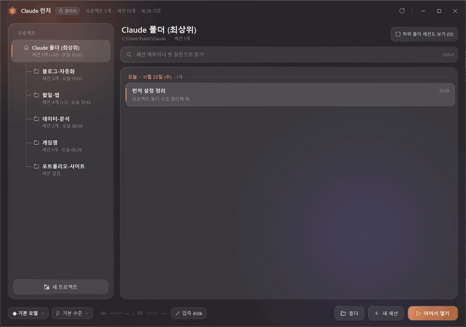
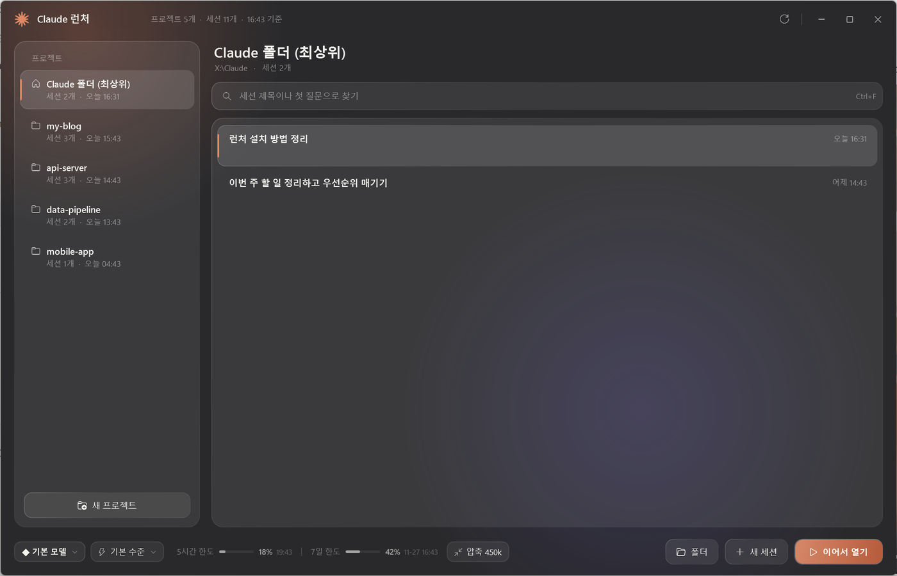
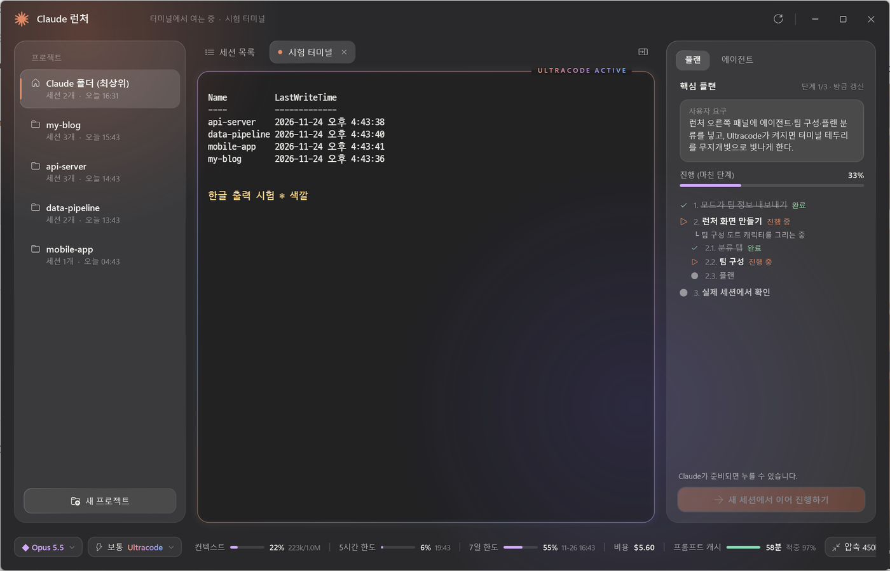

# Claude Launcher

[한국어](README.md) · **English**

A Windows app that groups your [Claude Code](https://claude.com/claude-code) sessions by project and reopens any of them in a built-in terminal tab with one click.

> Unofficial. Not made or endorsed by Anthropic. Windows only. The UI is in Korean.



<sub>Projects and sessions shown are fake demo data. [Full-quality video (MP4)](docs/teaser.mp4)</sub>



Once you've used Claude Code for a while you end up with dozens of sessions, and finding "that one conversation" again means scrolling through `claude --resume`. This launcher lists sessions per project folder, with search, so you can pick one and continue right away.



<sub>The "Plan" panel on the right is filled by a separate Claude Code mod that is not included here (see Notes).</sub>

## Features

- Projects and sessions under one root folder (default: `Desktop\Claude`), with search by title or first prompt
- Resume a session or start a new one, in a built-in terminal tab (xterm.js + WebView2) or Windows Terminal
- Pick the model and reasoning effort before opening
- 5-hour / 7-day usage limits, context usage and cost in the bottom bar
- Auto-compact threshold setting
- Handoff: summarize the current session and continue in a fresh one (saved in `handoff\`)

## Requirements

| | |
|---|---|
| Windows 10/11, 64-bit | .NET Framework 4.8 ships with Windows |
| Claude Code (`claude`) | `irm https://claude.ai/install.ps1 \| iex` |
| Node.js | `winget install OpenJS.NodeJS.LTS` (status line and limits) |
| WebView2 Runtime | Built into Windows 11. Otherwise `winget install Microsoft.EdgeWebView2Runtime` |
| Windows Terminal (optional) | For "open in external window" |

## Install

**Option 1: download and run.** Get `ClaudeLauncher-*-win-x64.zip` from [Releases](https://github.com/mingilee97/claude-cli-launcher/releases/latest), unzip it anywhere and run `ClaudeLauncher.exe`.

**Option 2: one line in PowerShell.**

```powershell
irm https://raw.githubusercontent.com/mingilee97/claude-cli-launcher/main/install.ps1 | iex
```

Downloads to `%LOCALAPPDATA%\ClaudeLauncher`, builds, and adds Desktop and Start menu shortcuts.

**Option 3: from source.**

```powershell
git clone https://github.com/mingilee97/claude-cli-launcher.git
cd claude-cli-launcher
.\setup.cmd
```

No Visual Studio or .NET SDK needed: `build.ps1` uses the `csc.exe` that comes with Windows and fetches the WebView2 SDK from NuGet.

## Configuration

- **Root folder**: `root` in `launcher-config.json` → env var `CLAUDE_LAUNCHER_ROOT` → `Desktop\Claude`.

  ```json
  { "root": "D:\\work\\Claude" }
  ```

- **Claude config folder**: `CLAUDE_CONFIG_DIR` if set, else `%USERPROFILE%\.claude`.
- `launcher-settings.json` is regenerated on every start for the current install path.

## Notes

- Runs with normal privileges by default. Build with `.\build.ps1 -Admin` (or `install.ps1 -Admin`) if you need sessions to run elevated.
- Runtime data (`status\`, `cache\`, `handoff\`, `plans\`, `webdata*\`) is created next to the exe and is git-ignored.
- The "Plan" and "Team" panels are fed by a personal Claude Code mod (korean-hud) that is not part of this repo; without it they stay empty.

## License

MIT. Bundled third-party files: [xterm.js](https://github.com/xtermjs/xterm.js) (MIT, `web/xterm-LICENSE.txt`), [D2Coding](https://github.com/naver/d2codingfont) font (SIL OFL 1.1, `web/D2Coding-OFL.txt`). The WebView2 SDK is downloaded from NuGet at build time.
